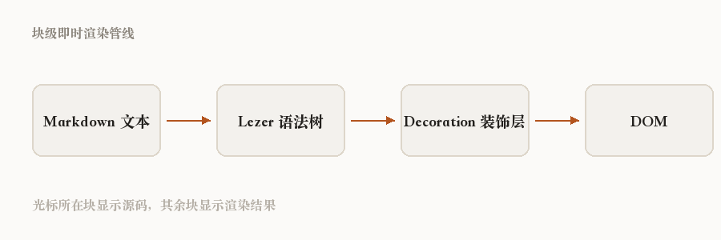

# 图片与附件

这一页专门测图片。回到[索引](../README.md)。

## 相对路径图片

下面用的是 `../素材/渲染管线.png`，工作区会自己解析成真实文件：

## 超出工作区的路径

下面这一行用 `..` 跳出了工作区根目录。出于安全，工作区不允许访问外部文件，所以它会退化成占位框：

正确的写法应该是这样：

## 图片带说明文字

alt 文本会渲染成图注，顺便支持行内格式：

## 找不到的图片

引用不存在的文件时，会退化成占位提示而不是裂图：

## 章节小结

| 写法 | 结果 |
| :--- | :--- |
| `` | 正常显示 + 图注 |
| `` | 直接加载远程图片 |
| 路径不存在 | 虚线占位框 |

延伸阅读：[块级即时渲染](块级即时渲染.md)
